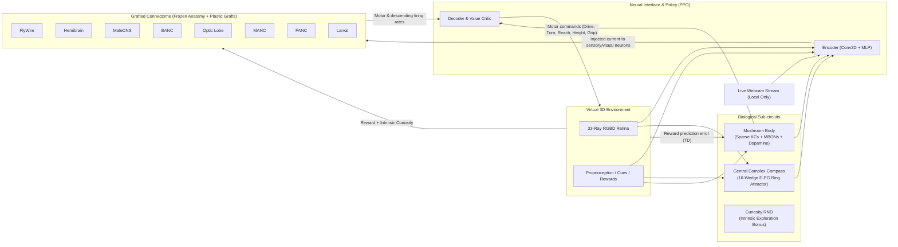

# GraftBrain

[](https://www.python.org/downloads/)
[](https://opensource.org/licenses/MIT)
[](https://fly-brain-hub.vercel.app/datasets)
[](https://arxiv.org/abs/1707.06347)

**GraftBrain** integrates electron-microscopy (EM) connectome datasets from [Fly Brain Hub](https://fly-brain-hub.vercel.app/datasets), fuses them into a single multi-site cross-wired neural network, and executes the system in closed-loop interaction with a virtual 3D environment and live sensory inputs (retina raycasting and webcam feeds).

The network is coupled in both directions with an artificial neural network (ANN) and biologically modeled sub-circuits (Central Complex ring attractor compass, Mushroom Body sparse Kenyon Cell associative memory, and Random Network Distillation curiosity). The entire state is continuously saved with atomic rolling checkpoints and auto-resumes across runs.

> [!IMPORTANT]
> **Scientific Grounding**: Connectome datasets are static anatomical wiring diagrams reconstructed from electron microscopy of preserved insect tissue. In GraftBrain, "grafting" denotes adding plastic, trainable synaptic routing layers between these biological graph representations, while "physically connected to a neural network" refers to a unified, end-to-end differentiable PyTorch computational graph. This reflects contemporary connectome-constrained computational neuroscience (e.g., *Shiu et al., Nature 2024*; *Lappalainen et al., Nature 2024*).

---

## Architecture Overview



---

## Key Features

1. **Multi-Connectome Ingestion & Provenance**
   - Incorporates all 8 major *Drosophila* connectome datasets: **FlyWire** (FAFB v783), **Hemibrain**, **MaleCNS**, **BANC**, **Optic Lobe**, **MANC**, **FANC**, and the **Larval Brain**.
   - Preserves neurotransmitter predictions (GABA and Glutamate mapped as inhibitory, Acetylcholine as excitatory).
   - Supports offline statistical proxies, direct FlyWire v783 Zenodo Apache Feather imports, neuPrint REST APIs, and arbitrary CSV edge-lists.

2. **Multi-Site Cross-Wiring ("Grafting")**
   - Rather than routing through an arbitrary single bottleneck, every pair of connectomes is cross-wired across three distinct structural mechanisms:
     - **Anatomical Interface Sites**: Preserves natural biological flow (brain descending neurons $\to$ nerve-cord motor circuits via the "neck connective", ascending neurons $\to$ central brain, optic lobe $\to$ central visual neuropils).
     - **Homolog Sites**: Reciprocally connects neurons sharing curated cell-type identifiers across releases.
     - **Reciprocal Central Bridges**: Spatially distributed multi-locus links across central neuropils.
   - The default configuration instantiates **177 distinct graft sites** with **~96,000 plastic graft synapses** bridging **12,000 neurons**.

3. **High-Performance Dynamical Rate Model (`index_add`)**
   - 4 recurrent microsteps per simulation step:
     $$\mathbf{x} = \mathbf{W}_{\text{conn}} \mathbf{r} + \mathbf{W}_{\text{graft}} \mathbf{r} + \mathbf{b} + \mathbf{I}_{\text{drive}}$$
     $$\mathbf{r} \leftarrow (1 - \alpha)\mathbf{r} + \alpha \cdot \text{ReLU}(\tanh(\mathbf{x})) + \epsilon$$
   - Employs vectorized PyTorch `index_add` operations instead of standard sparse COO/CSR matrix multiplication, delivering **>2.2x speedup** (~14 steps/s on CPU for 12,000 neurons).
   - Connectome weights remain frozen; graft weights adapt via online gradient descent and three-factor Hebbian plasticity.

4. **Biological Sub-Circuits**
   - **Central Complex Compass (`CentralComplexCompass`)**: Models the 16-wedge Ellipsoid Body (EB) ring attractor. Integrates angular velocity $\omega$ and anchors to high-contrast visual cues, maintaining an internal heading angle to prevent disorientation.
   - **Mushroom Body Associative Memory (`MushroomBody`)**: Implements sparse Kenyon Cells (~6% top-$k$ Winner-Take-All) with Dopaminergic Neurons (DANs) modulating Mushroom Body Output Neurons (MBONs) based on reward/punishment TD error.
   - **Homeostatic Firing Rate Regulation**: Local neuronal bias currents slowly drift to maintain population firing rates near a stable setpoint ($\bar{r} \approx 0.12$).
   - **Intrinsic Curiosity (`CuriosityRND`)**: Random Network Distillation provides exploration bonuses in sparse-reward tasks.

5. **Reinforcement Learning via PPO & GAE**
   - Proximal Policy Optimization (PPO) with clipped surrogate objective ($\epsilon = 0.2$).
   - Generalized Advantage Estimation ($\text{GAE}(\gamma=0.98, \lambda=0.95)$) reduces variance across recurrent rollouts.

6. **Interactive 3D Web Dashboard & Visualizer**
   - Full Three.js 3D viewport rendered at 60 FPS in any modern web browser.
   - Live **Central Complex Polar Radar** displaying the heading direction bump.
   - Live activity raster maps across all 8 connectomes.
   - Real-time graft site synaptic weight and signal flow monitor.

7. **Zero-Data-Loss Continuous State Persistence**
   - Atomic checkpoints every 60 seconds and on process shutdown (`state/graftbrain.pt`).
   - Rolling automated backups (`.pt.1`, `.pt.2`) with automatic corruption recovery.
   - Full event logging into append-only JSON Lines journals (`*_journal.jsonl`).

---

## Installation

### Prerequisites
* Python 3.10, 3.11, or 3.12
* Windows, macOS, or Linux

```powershell
# Clone or navigate to the workspace
cd "c:\Users\kai99\Desktop\New folder (10)"

# Install dependencies
pip install -r requirements.txt
```

### Optional Dependencies
```powershell
# For real-time neuPrint queries (Janelia Hemibrain, MANC, MaleCNS)
pip install neuprint-python
```

---

## Quick Start

### 1. Launch Interactive 3D Viewer & Simulation
```powershell
python -m graftbrain run
```
Open **[http://127.0.0.1:8770](http://127.0.0.1:8770)** in your browser.

### 2. Run with Live Webcam Input
```powershell
python -m graftbrain run --webcam
```
*Note: Camera frames are processed strictly in-memory into 48x64 downsampled motion-energy maps and are never saved to disk. The server binds exclusively to `127.0.0.1`.*

### 3. Accelerated Headless Training
```powershell
python -m graftbrain train --steps 20000 --autosave 60
```

### 4. Inspect Graft Topology & Connections
```powershell
python -m graftbrain info
```

---

## Environments & Cognitive Tasks

The agent is embodied as a mobile base equipped with a 2-degree-of-freedom arm (reach, height) and an open/close gripper. The world provides 9 distinct tasks across navigation, manipulation, and cognition:

| Task | Domain | Objective | Reward Scheme |
|---|---|---|---|
| `forage` | Navigation | Navigate to open-field food targets | Potential-based distance shaping + goal reward (+5.0) |
| `maze` | Navigation | Navigate a randomly generated DFS labyrinth | BFS geodesic distance gradient + exit reward (+8.0) |
| `push` | Manipulation | Push a heavy colored block onto a designated target pad | Box-to-pad distance delta + placement reward (+6.0) |
| `grasp_place` | Fine Motor | Approach a cube, grasp with gripper, lift, and drop into bin | Grasp bonus (+1.0) + distance to bin + deposit (+6.0) |
| `peg_insert` | Fine Motor | Align arm with peg, lift, and insert into tight circular hole | Precision alignment delta + insertion reward (+6.0) |
| `delayed_match` | Cognition | Observe sample cue color $\to$ 20-step delay $\to$ choose match | Correct match (+5.0), incorrect choice (-2.0) |
| `go_nogo` | Cognition | Green cue: reach target; Red cue: withhold action for 80 steps | Correct go/no-go (+3.0), false alarm/miss (-3.0) |
| `button_sequence` | Cognition | Observe 3-color sequence cue, then press matching buttons in order | Sequential button press (+2.0 each) + completion (+5.0) |
| `webcam_chase` | Sensorimotor | Track and chase a moving visual orb driven by live webcam motion | Azimuth alignment bonus + proximity reward (+0.02/step) |

---

## Real Connectome Ingestion

GraftBrain can seamlessly switch from built-in statistical proxies to official, full-scale connectome releases:

### FlyWire FAFB v783 (Zenodo)
```powershell
# 1. Download official FlyWire proofread connections (~1 GB, CC-BY-NC-4.0)
python -m graftbrain fetch-flywire

# 2. Run GraftBrain using FlyWire as the brain backbone
python -m graftbrain run --fresh -c flywire:data/proofread_connections_783.feather -c proxy:manc -c proxy:optic-lobe
```

### neuPrint (Janelia Hemibrain / MANC / MaleCNS)
```powershell
# Set your neuPrint API authorization token
$env:NEUPRINT_APPLICATION_CREDENTIALS = "<YOUR_TOKEN>"

# Run with direct neuPrint queries
python -m graftbrain run --fresh \
  -c neuprint:hemibrain:v1.2.1 \
  -c neuprint:manc:v1.2.1 \
  -c neuprint:optic-lobe:v1.1 \
  -c proxy:banc
```

### Generic CSV Ingestion
Any tabular network can be loaded with custom column mappings:
```powershell
python -m graftbrain run -c "csv:path/to/edges.csv@name=CustomCNS,kind=cns,annotations=nodes.csv"
```

---

## CLI Reference

```
usage: graftbrain [-h] {run,train,info,fetch-flywire} ...

positional arguments:
  run               Launch closed-loop simulation with live 3D web viewer
  train             Run headless accelerated training loop
  info              Inspect and summarize grafted connectome graph topology
  fetch-flywire     Download FlyWire v783 connectivity dataset (~1 GB)

options:
  -c, --connectome  Connectome specification (proxy:*, flywire:*, neuprint:*, csv:*)
  --max-neurons     Neuron budget per connectome (default: 1500)
  --state           Checkpoint save path (default: state/graftbrain.pt)
  --fresh           Ignore existing checkpoints and build new graph
  --task            Fixed task name or 'auto' curriculum
  --webcam          Enable live webcam processing
  --autosave        Autosave interval in seconds (default: 60)
  --microsteps      Neural microsteps per world step (default: 4)
  --port            Web server port for 'run' command (default: 8770)
  --steps           Step limit for 'train' command (default: 10000)
  --seed            Random seed (default: 0)
```

---

## Web Dashboard Guide

When running `python -m graftbrain run`, the dashboard at `http://127.0.0.1:8770` provides:

* **3D Viewport**: Orbit with Left Click + Drag, Pan with Right Click + Drag, Zoom with Scroll.
* **HUD (Top Left)**: Current task, elapsed step ($t$), episode index, cumulative return, and active visual cue color.
* **Control Bar**:
  * **Task Selector**: Force immediate curriculum switch to any of the 9 tasks.
  * **Pause / Resume**: Freeze physics and neural dynamics.
  * **Save Now**: Trigger an immediate atomic checkpoint.
  * **Reset Activity**: Zero all membrane voltages and eligibility traces while preserving learned weights.
  * **Speed Slider**: Throttle execution from 1 Hz up to 120 Hz or unthrottled maximum.
* **Telemetry Panels**:
  * **Central Complex Radar**: Polar rendering of the 16 E-PG heading wedges.
  * **Mushroom Body**: Live Kenyon Cell activation percentage and MBON approach/avoidance valence.
  * **Return Chart**: Rolling 200-episode learning curve.
  * **Success Rate**: Rolling 50-episode completion rates per task.
  * **Connectome Rasters**: Live activity heatmaps across each sub-graph.
  * **Graft Sites Table**: Real-time traffic, synapse count, and $|w|$ across the top cross-wiring sites.

---

## Verification & Testing

Every task includes an automated oracle controller to verify physical solvability:

```powershell
python tests/test_tasks.py
```

Expected output:
```
forage           oracle success 10/10
maze             oracle success 10/10
push             oracle success 10/10
grasp_place      oracle success 10/10
peg_insert       oracle success 10/10
delayed_match    oracle success 10/10
go_nogo          oracle success 10/10
button_sequence  oracle success 10/10
webcam_chase     oracle success 10/10
```

---

## Scientific Citations & Attributions

When utilizing experimental datasets in academic research, please cite the respective sources:

* **FlyWire Whole-Brain Connectome (v783)**:
  * Dorkenwald, S. et al. *Neuronal wiring diagram of an adult brain.* Nature 634, 124–138 (2024). DOI: [10.1038/s41586-024-07558-y](https://doi.org/10.1038/s41586-024-07558-y).
  * Schlegel, P. et al. *Whole-brain annotation and multi-connectome mapping of Drosophila.* Nature 634, 139–152 (2024).
  * Shiu, P. K. et al. *A leaky integrate-and-fire computational model of the adult Drosophila brain.* Nature 634, 153–165 (2024).
* **Hemibrain Connectome**:
  * Scheffer, L. K. et al. *A connectome and analysis of the adult Drosophila central brain.* eLife 9:e57443 (2020).
* **Male Adult Nerve Cord (MANC)**:
  * Takemura, S. et al. *A connectome of the male Drosophila ventral nerve cord.* bioRxiv (2023).
* **Central Complex Compass & Navigation**:
  * Seelig, J. D. & Jayaraman, V. *Neural dynamics for landmark orientation and angular path integration.* Nature 521, 186–191 (2015).
  * Hulse, B. K. et al. *A connectome of the Drosophila central complex reveals network motifs suitable for flexible navigation and goal-directed behavior.* eLife 10:e66039 (2021).

---

## License

This software codebase is released under the [MIT License](LICENSE). Connectome datasets (FlyWire, Hemibrain, etc.) are governed by their respective licenses (CC-BY-4.0 / CC-BY-NC-4.0); please observe data license terms when using raw connectome weights.
